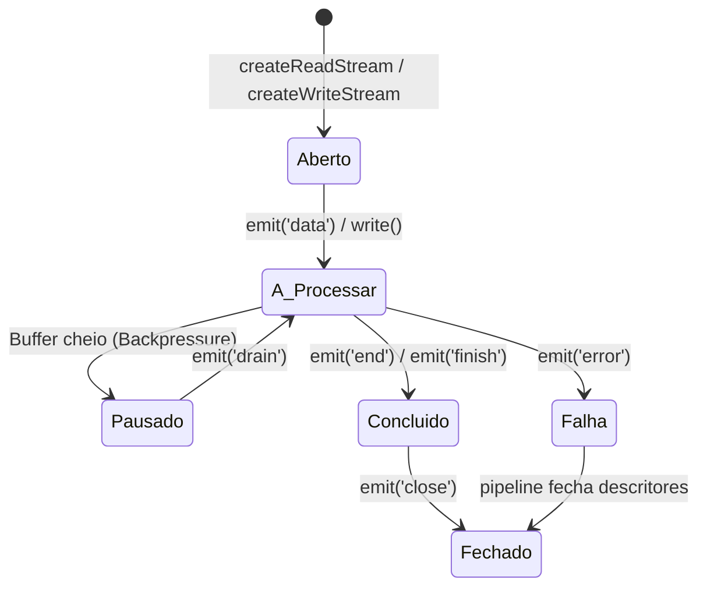

# Aula 08: Tratamento Robusto de Erros Assíncronos e Ciclo de Vida de Streams

- **Data:** 2026-11-18 (Quarta-feira)
- **Semana:** Semana 02 — JavaScript Assíncrono no Backend
- **Duração da Sessão:** 90 minutos (15 min revisão activa | 25 min teoria | 40 min código guiado | 10 min registo)

---

## 1. Tema

Propagação de excepções em cadeias de `async/await`, ciclo de vida completo de streams no Node.js (eventos `drain`, `finish`, `close`, `error`) e controlo defensivo de fluxo sem fugas de memória.

---

## 2. Objectivos de Aprendizagem

- [ ] Compreender com precisão como o `throw` interrompe a execução de funções assíncronas aninhadas.
- [ ] Dominar o ciclo de vida e os eventos fundamentais de Streams (`data`, `end`, `error`, `drain`, `close`).
- [ ] Aplicar a metodologia **"Como Criar do Zero"** para construir validadores assíncronos e filtros de stream sem bloqueios de raciocínio.
- [ ] Proteger o backend da plataforma de vídeo-aulas contra travamentos por excepções não tratadas (*Unhandled Rejections*).

---

## 3. Revisão Activa: O teu Teste em `src/event-loop-quiz.ts`

Criaste um teste excelente com funções assíncronas aninhadas:

```typescript
async function getUser() {
  console.log("A");
  throw new Error("Erro no utilizador");
}

async function getProfile() {
  console.log("B");
  await getUser();
  console.log("C");
}

async function main() {
  try {
    console.log("D");
    await getProfile();
    console.log("E");
  } catch (error: any) {
    console.log("Catch:", error.message);
  }
  console.log("F");
}

main();
console.log("G");
```

### O que previste vs O que aconteceu:
- **A tua previsão:** `D, B, A, G, Catch, C, E, F`
- **Resultado real na consola:** `D, B, A, G, Catch, F`

### Porquê esta ordem?
1. `main()` inicia de forma síncrona: imprime **`D`**.
2. Chama `await getProfile()`: entra na função e imprime **`B`**.
3. Chama `await getUser()`: entra na função e imprime **`A`**.
4. Em `getUser()`, ocorre `throw new Error(...)`:
   - O `throw` **aborta a função no mesmo instante**.
   - Como `getUser` falhou, a linha `console.log("C")` **nunca é executada**!
   - A função `main` ainda está pausada no `await`, logo o JavaScript liberta a thread e continua o código síncrono exterior: imprime **`G`**.
5. Quando a microtarefa da rejeição é processada, ela sobe de `getUser` $\rightarrow$ para `getProfile` $\rightarrow$ e é apanhada no `try/catch` de `main()`:
   - Imprime **`Catch: Erro no utilizador`**.
   - Como o erro saltou directamente para o `catch`, a linha `console.log("E")` **nunca é executada**!
6. O bloco `try/catch` encerra com sucesso e o código continua: imprime **`F`**.

---

## 4. Explicação dos Conceitos: Ciclo de Vida de Streams

No processamento de ficheiros de vídeo ou grandes volumes de dados, uma Stream atravessa estados bem definidos:



- **`drain`:** Quando uma stream de escrita enche o buffer em memória, ela avisa *"espera um pouco"*. Quando o disco ou rede esvazia esse buffer, ela emite o evento `drain` (*"podes voltar a enviar dados"*).
- **`finish` vs `end`:** 
  - `end` ocorre em Streams de **Leitura** quando não há mais dados para ler.
  - `finish` ocorre em Streams de **Escrita** quando todos os dados foram gravados no destino.
- **`close`:** O descritor de ficheiro do sistema operacional foi encerrado.

---

## 5. Como Criar do Zero (Anatomia e Esqueleto Passo a Passo)

Como combinámos, tens aqui o guia de construção passo a passo:

### 5.1. Esqueleto 1: Tratamento de Erros Assíncronos com Padrão de Resultado Seguro (Result Pattern)

Em APIs profissionais, evitar depender exclusivamente de `try/catch` espalhado melhora a legibilidade. Criamos uma função utilitária `safeAsync`:

```typescript
// PASSO 1: O esqueleto da função de proteção
export async function safeAsync<T>(promise: Promise<T>): Promise<[Error | null, T | null]> {
  try {
    const data = await promise;
    return [null, data]; // Posição 0: sem erro, Posição 1: dados
  } catch (err) {
    const error = err instanceof Error ? err : new Error(String(err));
    return [error, null]; // Posição 0: erro capturado, Posição 1: nulo
  }
}
```

### 5.2. Esqueleto 2: Como Criar um Consumidor de Stream Manual com Controlo de Backpressure

```typescript
import { createWriteStream } from "node:fs";

// PASSO 1: Criar a stream de destino
const escritor = createWriteStream("destino.txt");

// PASSO 2: Função que escreve respeitando a drenagem (drain)
export async function escreverLinhaSegura(stream: NodeJS.WritableStream, linha: string): Promise<void> {
  const podeContinuar = stream.write(linha);
  
  // Se o buffer encher (podeContinuar === false), aguarda o evento drain antes de prosseguir
  if (!podeContinuar) {
    await new Promise((resolve) => stream.once("drain", resolve));
  }
}
```

---

## 6. Aplicação no Projecto da Empresa (Vídeo-Aulas)

1. **Evitar Falhas no Upload:** Quando o produtor envia um ficheiro de vídeo, se a conexão oscilar ou o utilizador cancelar a requisição, o evento `close` do stream HTTP do Express dispara. Devemos cancelar o stream de gravação para não deixar ficheiros temporários órfãos no disco.
2. **Pipelines com Tratamento:** O uso de `pipeline` (que aplicámos ontem) garante que se a gravação falhar a meio do upload, o Node.js emite o erro de forma controlada sem deitar a aplicação abaixo.

---

## 7. Critérios de Conclusão da Aula

- [ ] Compreensão da razão pela qual `C` e `E` foram omitidos no teu teste do quiz.
- [ ] Execução prática do padrão de tratamento seguro `safeAsync`.
- [ ] Registo dos 10 minutos finais no painel de controlo.
