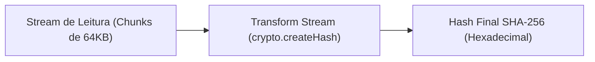

# Aula 09: Pipeline Assíncrono Completo, Validação Binária (Magic Bytes) e Hashes com Streams

- **Data:** 2026-11-19 (Quinta-feira)
- **Semana:** Semana 02 — JavaScript Assíncrono no Backend
- **Duração da Sessão:** 90 minutos (15 min revisão activa | 25 min teoria | 40 min código guiado | 10 min registo)

---

## 1. Tema

Construção de um pipeline assíncrono de ingestão de ficheiros: validação da assinatura binária real (*Magic Bytes*) usando `Buffer`, cálculo de integridade criptográfica (SHA-256) em tempo real com `node:crypto` via Streams, e tratamento defensivo com `safeAsync`.

---

## 2. Objectivos de Aprendizagem

- [ ] Compreender por que a extensão de um ficheiro (`.mp4`, `.png`) é insegura e como inspecionar os primeiros bytes binários de um `Buffer` (*Magic Numbers*).
- [ ] Integrar `createHash` do módulo nativo `node:crypto` directamente num pipeline de Streams.
- [ ] Aplicar o padrão `safeAsync` construído na Aula 08 para capturar e formatar falhas em tempo real sem blocos `try/catch` redundantes.
- [ ] Desenvolver um serviço coeso que simula a porta de entrada de vídeos da plataforma da empresa.

---

## 3. Revisão Activa: O que Consolidámos até Aqui

Na Aula 08 construímos o utilitário [`src/safe-async.ts`](file:///home/cesar-antonio/Documentos/projectos/nodejs-backend-roadmap/src/safe-async.ts):
```typescript
export type SafeResult<T> = [Error, null] | [null, T];

export async function safeAsync<T>(promise: Promise<T>): Promise<SafeResult<T>> {
  try {
    const data = await promise;
    return [null, data];
  } catch (err) {
    const error = err instanceof Error ? err : new Error(String(err));
    return [error, null];
  }
}
```
**O Ganho Técnico:** Em vez de a aplicação rebentar ou precisarmos de `try/catch` aninhados em cada operação I/O, recebemos `[err, data]` com total segurança de tipos no TypeScript.

---

## 4. Explicação dos Conceitos

### 4.1. O Perigo da Extensão do Ficheiro vs Magic Bytes
Numa plataforma de vídeo-aulas onde os utilizadores enviam ficheiros:
- Um atacante pode renomear um script malicioso ou ficheiro binário (`virus.exe` ou `shell.sh`) para `aula-01.mp4`.
- Validar apenas o nome (`filename.endsWith('.mp4')`) é uma falha grave de segurança.
- **A Solução:** Ler os primeiros 8 a 16 bytes do ficheiro (o cabeçalho binário) e verificar a assinatura real:
  - Ficheiros MP4 começam com bytes específicos (ex.: padrão `ftyp` na posição 4 a 8: `66 74 79 70`).
  - Ficheiros PDF começam com `%PDF` (`25 50 44 46`).
  - Ficheiros PNG começam com `89 50 4E 47 0D 0A 1A 0A`.

### 4.2. Cálculo de Hash Criptográfico em Streaming
Quando um vídeo de 500 MB é enviado, como garantimos que o ficheiro guardado no disco ou na cloud é exactamente igual ao ficheiro enviado (sem corrupção de rede)?
- Calculamos o **checksum SHA-256**.
- Se tentarmos carregar os 500 MB para a memória com `fs.readFile` para calcular o hash, voltamos a ter o problema de memória.
- No Node.js, a classe de hash do módulo nativo `node:crypto` é uma **`Transform Stream`**! Ela consome os chunks de 64 KB à medida que passam e calcula o hash incrementalmente.



---

## 5. Como Criar do Zero (Anatomia e Esqueleto Passo a Passo)

### 5.1. Esqueleto 1: Como ler os Magic Bytes de um ficheiro com `fs/promises` e `Buffer`

```typescript
import { open } from "node:fs/promises";
import { Buffer } from "node:buffer";

// PASSO 1: Abrir o ficheiro apenas para leitura (flag 'r')
export async function getFileHeader(filePath: string, bytesToRead = 8): Promise<Buffer> {
  const fileHandle = await open(filePath, "r");
  try {
    // Aloca um buffer pequeno (apenas 8 bytes)
    const buffer = Buffer.alloc(bytesToRead);
    // Lê apenas os primeiros 8 bytes do ficheiro
    await fileHandle.read(buffer, 0, bytesToRead, 0);
    return buffer;
  } finally {
    // Fecha o handle de ficheiro obrigatoriamente
    await fileHandle.close();
  }
}
```

### 5.2. Esqueleto 2: Como calcular o Hash SHA-256 com Streams

```typescript
import { createReadStream } from "node:fs";
import { createHash } from "node:crypto";
import { pipeline } from "node:stream/promises";

export async function calculateFileHash(filePath: string): Promise<string> {
  // 1. Cria a stream de hash do módulo 'node:crypto'
  const hasher = createHash("sha256");

  // 2. Conecta o leitor do ficheiro ao hasher via pipeline
  await pipeline(
    createReadStream(filePath),
    hasher
  );

  // 3. Obtém o resultado em formato hexadecimal legível
  return hasher.digest("hex");
}
```

---

## 6. Aplicação no Projecto da Empresa (Vídeo-Aulas)

1. **Segurança de Upload:** Antes de aceitar qualquer upload de vídeo de um produtor, a API lê os primeiros 16 bytes e valida se é de facto um contentor MP4/WebM legítimo.
2. **Deduplicação de Vídeos:** Ao calcular o SHA-256 via stream, se dois utilizadores fizerem upload do mesmo vídeo idêntico, a plataforma detecta o mesmo hash e evita duplicar armazenamento caro no S3/Cloudflare R2!
3. **Resiliência Total:** Toda a verificação é encapsulada com `safeAsync`, garantindo que se o ficheiro estiver corrompido, o endpoint responde com `HTTP 400 Bad Request` claro em vez de um erro 500 não tratado.

---

## 7. Critérios de Conclusão da Aula

- [ ] Compreensão prática da validação por Magic Bytes em vez de extensão de ficheiro.
- [ ] Implementação do serviço de validação de ficheiros com SHA-256 via Stream.
- [ ] Execução com sucesso do teste demonstrativo com zero erros de compilação.
