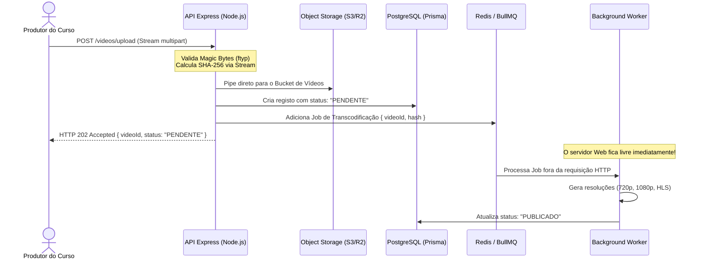

# Aula 10: Aplicação no Projecto da Empresa — Arquitectura Assíncrona de Vídeo e Pagamentos

- **Data:** 2026-11-20 (Sexta-feira)
- **Semana:** Semana 02 — JavaScript Assíncrono no Backend
- **Duração da Sessão:** 90 minutos (15 min revisão activa | 25 min teoria arquitectural | 40 min registo prático & ADR | 10 min registo)

---

## 1. Tema

Aplicação dos conceitos da Semana 02 (Event Loop, Streams, Buffers, Hashes criptográficos e resiliência com `safeAsync`) na arquitectura real da **Plataforma de Vídeo-Aulas** da empresa, com formalização de uma ADR (*Architecture Decision Record*) para a ingestão de vídeos e fluxo assíncrono de pagamentos.

---

## 2. Objectivos de Aprendizagem

- [ ] Desenhar o fluxo assíncrono de ponta a ponta para a plataforma de vídeo-aulas (Cliente $\rightarrow$ API $\rightarrow$ Object Storage $\rightarrow$ Fila BullMQ/Worker).
- [ ] Compreender por que a conversão de vídeos (transcodificação) **nunca** pode ocorrer dentro do ciclo de vida de uma requisição HTTP do Express.
- [ ] Estruturar a primeira ADR real da empresa: **ADR-001: Ingestão de Vídeos por Streams e Processamento Assíncrono**.
- [ ] Alinhar o padrão `safeAsync` com a recepção de webhooks de pagamento de clientes.

---

## 3. Revisão Activa: O Pipeline da Semana 02

Ao longo desta semana, construíste e testaste três pilares de código:
1. [`src/orchestrator.ts`](file:///home/cesar-antonio/Documentos/projectos/nodejs-backend-roadmap/src/orchestrator.ts): Concorrência paralela resiliente com `Promise.allSettled`.
2. [`src/stream-processor.ts`](file:///home/cesar-antonio/Documentos/projectos/nodejs-backend-roadmap/src/stream-processor.ts): Leitura e transformação de 50.000 registos com `createReadStream`, `Transform` e `pipeline` com memória RAM estável em ~11 MB.
3. [`src/video-ingestion.ts`](file:///home/cesar-antonio/Documentos/projectos/nodejs-backend-roadmap/src/video-ingestion.ts): Validação de assinatura binária (*Magic Bytes* `ftyp`) e hash SHA-256 via stream com captura segura através do utilitário `safeAsync`.

---

## 4. Arquitectura Corporativa: O Ciclo de Ingestão de Vídeos

Na tua plataforma de cursos, o fluxo profissional desenhado para evitar estrangulamentos no servidor Node.js é o seguinte:

### Porquê o Status `HTTP 202 Accepted` em vez de `HTTP 200 OK`?
- Converter um vídeo de 30 minutos em várias resoluções pode demorar de 2 a 10 minutos.
- Manter uma conexão HTTP aberta durante 5 minutos causa **timeout** no browser/proxy (Nginx/Cloudflare fecha após 60s) e consome descritores de rede desnecessários.
- O padrão REST para tarefas assíncronas de longa duração é responder imediatamente com `HTTP 202 Accepted` e o identificador do recurso para acompanhamento.

---

## 5. Como Criar do Zero (Anatomia de uma ADR Profissional)

Como combinámos, tens aqui o guia passo a passo para redigir uma Decisão de Arquitectura (*ADR*):

1. **Título e Número:** Identificador sequencial (`ADR-001`, `ADR-002`).
2. **Contexto:** Qual era a dor, o problema de negócio ou o risco técnico? (Ex.: risco de crash por falta de memória RAM em uploads de vídeo).
3. **Decisão Adoptada:** Qual foi a escolha arquitectural e as bibliotecas envolvidas? (Ex.: Streams + BullMQ + S3).
4. **Alternativas Descartadas:** Por que não guardámos o ficheiro inteiro em memória com `fs.readFile`? Por que não processámos o vídeo no mesmo processo do Express?
5. **Consequências Positivas:** Escalabilidade, estabilidade do servidor e baixo consumo de RAM.
6. **Trade-offs / Complexidade:** Necessidade de ter o Redis a correr para a fila de background.

---

## 6. Aplicação nos Documentos de Integração da Empresa

Nesta sessão, transferimos esta decisão para a documentação técnica oficial:
- [`integracao-empresa/decisoes-tecnicas.md`](file:///home/cesar-antonio/Documentos/projectos/nodejs-backend-roadmap/integracao-empresa/decisoes-tecnicas.md): Criação da **ADR-001**.
- [`integracao-empresa/funcionalidades.md`](file:///home/cesar-antonio/Documentos/projectos/nodejs-backend-roadmap/integracao-empresa/funcionalidades.md): Registo do módulo de ingestão assíncrona.

---

## 7. Critérios de Conclusão da Aula

- [ ] Desenho do fluxo assíncrono com `HTTP 202 Accepted` e fila BullMQ compreendido.
- [ ] Registo formal da ADR-001 no ficheiro da empresa.
- [ ] Actualização das horas acumuladas no painel de progresso (16h30 / 108h).
