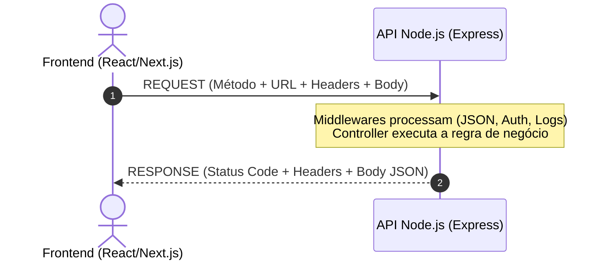

# Aula 12: Protocolo HTTP a Fundo, REST e o Primeiro Servidor Express com TypeScript

- **Data:** 2026-11-23 (Segunda-feira)
- **Semana:** Semana 03 — Protocolo HTTP, REST e Express.js
- **Fase:** Fase 2 — APIs e Arquitectura
- **Duração da Sessão:** 90 minutos (15 min revisão e abertura de fase | 25 min teoria HTTP | 40 min código guiado | 10 min registo)

---

## 1. Tema

Transição da programação assíncrona pura para a construção de APIs de rede: compreensão aprofundada da arquitectura cliente-servidor, anatomia das mensagens HTTP (Headers, Body, Métodos e Status Codes semânticos), e montagem do primeiro servidor web modular com **Express.js** e **TypeScript estrito**.

---

## 2. Objectivos de Aprendizagem

- [ ] Explicar a diferença entre comunicação sem estado (*stateless*) do protocolo HTTP e a gestão de sessões.
- [ ] Aplicar com rigor semântico os métodos HTTP (GET, POST, PUT, PATCH, DELETE) e Status Codes (200, 201, 204, 400, 404, 500).
- [ ] Compreender o ciclo de vida da requisição no Express: o pipeline de **Middlewares** (`req`, `res`, `next`).
- [ ] Instalar e configurar as dependências de produção do Express com os tipos oficiais (`@types/express`).
- [ ] Construir o primeiro servidor web tipado da **Plataforma de Vídeo-Aulas** com suporte a JSON.

---

## 3. Revisão Activa e Entrada na Fase 2

Concluímos com 100% de aproveitamento a **Fase 1: Fundamentos de Node.js**:
- Dominas o Event Loop, V8, libuv, Microtasks vs Macrotasks.
- Sabes manipular Streams e Buffers sem estourar a memória RAM.
- Tens em mãos o padrão Result (`safeAsync`) e a **ADR-001** de ingestão assíncrona.

Agora, na **Fase 2**, vamos transformar todo esse poder de processamento numa **API RESTful** que o Frontend (React/Next.js) e aplicações móveis possam consumir através da Internet.

---

## 4. Explicação dos Conceitos: O Protocolo HTTP

O HTTP (*Hypertext Transfer Protocol*) é um protocolo baseado em texto sobre TCP/IP no modelo **Pergunta e Resposta**:



### 4.1. Anatomia de uma Requisição (Request)
Uma requisição HTTP transporta 4 partes fundamentais:
1. **Método Semântico (Verbo):**
   - `GET`: Obter recursos (idempotente e seguro; nunca deve alterar dados no banco).
   - `POST`: Criar um novo recurso (ex.: cadastrar um curso ou registrar um pagamento).
   - `PUT`: Substituir completamente um recurso existente.
   - `PATCH`: Actualizar parcialmente campos específicos de um recurso.
   - `DELETE`: Remover um recurso.
2. **URL / Caminho:** Ex.: `/api/v1/courses/101`.
3. **Cabeçalhos (Headers):** Metadados da comunicação:
   - `Content-Type: application/json`: Diz que o corpo está em formato JSON.
   - `Authorization: Bearer <token>`: Transporta o token JWT.
4. **Corpo (Body):** Payload de dados enviado no POST, PUT e PATCH.

### 4.2. Status Codes: A Linguagem das Respostas
Nunca devolvas `200 OK` quando algo deu errado! Os códigos de estado dividem-se em 5 famílias:
- **2xx (Sucesso):**
  - `200 OK`: Requisição processada com retorno de dados.
  - `201 Created`: Novo recurso foi criado com sucesso (no POST).
  - `202 Accepted`: Requisição aceite para processamento assíncrono em background.
  - `204 No Content`: Sucesso, mas sem corpo de resposta (típico no DELETE).
- **4xx (Erro do Cliente):**
  - `400 Bad Request`: Dados inválidos enviados pelo cliente.
  - `401 Unauthorized`: Utilizador não autenticado (falta token ou token inválido).
  - `403 Forbidden`: Utilizador autenticado, mas sem permissão de acesso (ex.: aluno tentando apagar um curso).
  - `404 Not Found`: Rota ou recurso inexistente.
  - `409 Conflict`: Conflito de integridade (ex.: e-mail já registado).
- **5xx (Erro do Servidor):**
  - `500 Internal Server Error`: Falha inesperada ou excepção não tratada no backend.

---

## 5. Como Criar do Zero (Anatomia e Esqueleto Passo a Passo)

### Passo 1: Instalação das Dependências
No terminal do projecto:
```bash
npm install express
npm install -D @types/express
```

### Passo 2: O Esqueleto Mínimo Funcional em TypeScript

```typescript
import express, { Request, Response } from "express";

// 1. Criação da instância da aplicação Express
const app = express();

// 2. Middleware OBRIGATÓRIO para o Express conseguir ler JSON no req.body
app.use(express.json());

// 3. Primeira rota: GET de verificação de saúde da API
app.get("/health", (req: Request, res: Response) => {
  res.status(200).json({ status: "ok", timestamp: new Date().toISOString() });
});

// 4. Arrancar o servidor na porta desejada
const PORT = 3333;
app.listen(PORT, () => {
  console.log(`🚀 Servidor HTTP a correr em http://localhost:${PORT}`);
});
```

### Passo 3: Anatomia das 3 Formas de Receber Dados no Express

1. **`req.params` (Route Parameters):**
   - Rota: `/courses/:id`
   - Requisição: `GET /courses/42`
   - Acesso no código: `const { id } = req.params;` (string)
2. **`req.query` (Query Parameters / URL Search):**
   - Requisição: `GET /courses?categoria=backend&page=1`
   - Acesso no código: `const { categoria, page } = req.query;`
3. **`req.body` (Corpo JSON):**
   - Requisição: `POST /courses` com JSON `{ "titulo": "Node.js", "preco": 15000 }`
   - Acesso no código: `const { titulo, preco } = req.body;`

---

## 6. Aplicação no Projecto da Empresa (Plataforma de Vídeo-Aulas)

Na plataforma de cursos da tua empresa, vamos estruturar o primeiro recurso: **Catálogo de Cursos**:
- `GET /courses`: Lista todos os cursos disponíveis para os alunos.
- `GET /courses/:id`: Obtém detalhes de um curso específico.
- `POST /courses`: Criação de um curso pelo produtor (com status 201 Created).

---

## 7. Critérios de Conclusão da Aula

- [ ] Instalação de `express` e `@types/express` confirmada no `package.json`.
- [ ] Servidor Express criado e tipado em `src/server.ts`.
- [ ] Teste das rotas com cliente HTTP ou `curl` com status codes 200, 201 e 404.
- [ ] Painel `progresso.md` actualizado para a Semana 03.
