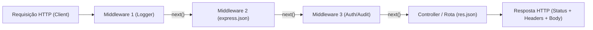

# Aula 13: A Mecânica dos Middlewares no Express, Intercepção e Medição de Performance

- **Data:** 2026-11-24 (Terça-feira)
- **Semana:** Semana 03 — Protocolo HTTP, REST e Express.js
- **Fase:** Fase 2 — APIs e Arquitectura
- **Duração da Sessão:** 90 minutos (15 min revisão das tarefas | 25 min teoria de middlewares | 40 min código guiado | 10 min registo)

---

## 1. Tema

Compreensão profunda do pipeline de execução de **Middlewares** no Express.js, controlo de fluxo com a função `next()`, ciclo de vida do objecto `res` com o evento `finish`, e injecção de cabeçalhos HTTP customizados (`X-Response-Time`) para auditoria de latência.

---

## 2. Objectivos de Aprendizagem

- [ ] Explicar a assinatura canónica de um middleware: `(req: Request, res: Response, next: NextFunction)`.
- [ ] Compreender o que acontece quando nos esquecemos de chamar `next()` (a requisição fica pendente até dar *timeout*).
- [ ] Medir o tempo de execução com precisão de alta resolução usando `process.hrtime.bigint()` ou `performance.now()`.
- [ ] Resolver o **Exercício 3.2**: criar um middleware global de auditoria que regista métricas e adiciona o cabeçalho `X-Response-Time`.
- [ ] Aplicar middlewares modulares na plataforma de vídeo-aulas da empresa para rastreabilidade de requisições.

---

## 3. Revisão Activa: As Tarefas Implementadas em `src/server.ts`

Excelente trabalho nas tarefas da Aula 12! Adicionaste directamente em [`src/server.ts`](file:///home/cesar-antonio/Documentos/projectos/nodejs-backend-roadmap/src/server.ts):
- ✅ **Tarefa 01:** `GET /api/v1/info` com status 200 e JSON estructurado.
- ✅ **Tarefa 02:** `GET /ping` com status 200 e timestamp ISO dinâmico.
- ✅ **Tarefa 03:** `POST /test-created` com status 201 e dados capturados do `req.body`.
- ✅ **Tarefa 04:** `DELETE /clear-session` com status 204 e `.send()` sem corpo.

Todas as respostas respeitaram a semântica HTTP com precisão!

---

## 4. Explicação dos Conceitos: A Mecânica dos Middlewares

No Express, **tudo é um middleware**. Uma aplicação Express é essencialmente uma fila ordenada de funções pelas quais a requisição passa até que uma resposta seja enviada ao cliente.



### 4.1. As Três Acções Possíveis de um Middleware
Quando o Express entrega o pedido a um middleware, ele **tem obrigatoriamente** de fazer uma de três coisas:
1. **Passar para o próximo:** Chamar `next()` para dar a vez ao próximo middleware da fila.
2. **Encerrar a requisição:** Responder imediatamente ao cliente (ex.: `res.status(401).json({ error: "Não autorizado" })`). Se responder, **não** deve chamar `next()`.
3. **Propagar um erro:** Chamar `next(error)` para passar o controlo para o middleware global de tratamento de erros.

> [!WARNING]
> Se um middleware não chamar `next()` e não responder com `res.send()/res.json()`, o cliente ficará eternamente à espera até a conexão cair por timeout do navegador!

### 4.2. O Problema da Medição de Tempo: Antes vs Depois
Como medir quanto tempo uma rota demorou a consultar o banco de dados ou processar um vídeo?
- Quando o middleware corre pela primeira vez, a rota ainda não foi executada.
- Se medires logo a seguir a `next()`, em código assíncrono a medição sai errada.
- **A Solução:** Ouvir o evento `res.on("finish", () => { ... })`. Esse evento dispara exactamente no milissegundo em que o Node.js termina de enviar todos os bytes da resposta pela rede!

---

## 5. Como Criar do Zero (Anatomia e Esqueleto Passo a Passo)

### Passo 1: O que Importar
```typescript
import { Request, Response, NextFunction } from "express";
import process from "node:process";
```

### Passo 2: O Esqueleto Mínimo de um Middleware com Medição de Tempo

```typescript
export function requestTimerMiddleware(req: Request, res: Response, next: NextFunction): void {
  // 1. Marca o início do tempo com precisão de nanossegundos
  const start = process.hrtime.bigint();

  // 2. Ouve o evento 'finish' para calcular o tempo total quando a resposta for enviada
  res.on("finish", () => {
    const end = process.hrtime.bigint();
    // Converte nanossegundos para milissegundos com 2 casas decimais
    const durationMs = (Number(end - start) / 1_000_000).toFixed(2);

    console.log(`[${req.method}] ${req.originalUrl} -> ${res.statusCode} (${durationMs}ms)`);
  });

  // 3. Chama next() OBRIGATORIAMENTE para não travar a aplicação!
  next();
}
```

### Passo 3: Como Injetar o Cabeçalho `X-Response-Time`
Para o cabeçalho viajar na resposta até ao cliente (Frontend), temos de defini-lo **antes** de a resposta ser enviada:

```typescript
export function responseTimeHeaderMiddleware(req: Request, res: Response, next: NextFunction): void {
  const start = Date.now();

  // Modifica a função res.send para injetar o header antes de disparar
  const originalSend = res.send;
  res.send = function (body) {
    const duration = Date.now() - start;
    res.setHeader("X-Response-Time", `${duration}ms`);
    return originalSend.call(this, body);
  };

  next();
}
```

---

## 6. Aplicação no Projecto da Empresa (Plataforma de Vídeo-Aulas)

1. **Rastreabilidade de Requisições (Request ID):** Cada chamada que chega à API recebe um `X-Request-Id` gerado por middleware. Se um utilizador reclamar de falha no pagamento ou no upload, o Frontend envia esse ID e conseguimos localizar a linha exacta nos logs do servidor.
2. **Monitorização de Performance:** Identificar endpoints lentos (ex.: listagem de vídeos sem paginação demorando mais de 500ms) sem precisar de ferramentas pagas de APM.

---

## 7. Critérios de Conclusão da Aula

- [ ] Exercício 3.2 implementado e testado.
- [ ] Cabeçalho `X-Response-Time` verificado nas respostas.
- [ ] Registo formal no caderno de exercícios e actualização do `progresso.md`.
